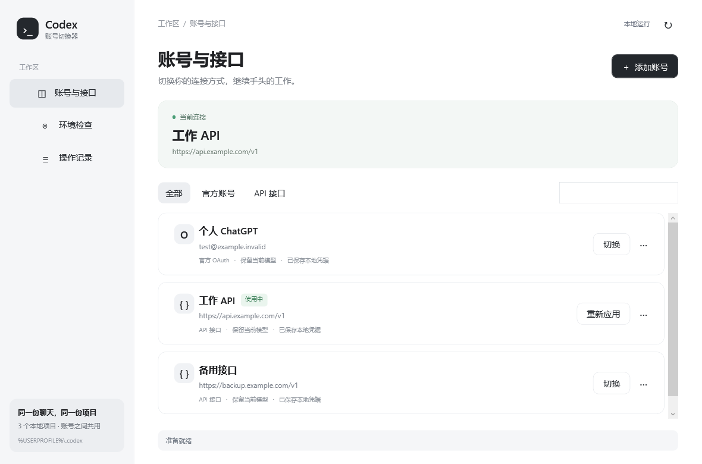

# Codex Profile Switcher

**A Windows desktop app for switching between Codex OAuth accounts and API profiles while keeping one shared local workspace.**

面向 Windows 的 Codex 账号与 API 管理工具。用图形界面管理多个官方账号和 API 连接；所有档案继续使用当前 Codex 聊天、项目和工作目录。

## 下载

从 [GitHub Releases](https://github.com/IIMovoMII/Codex-Profile-Switcher/releases) 下载最新的 **Codex-Profile-Switcher-Setup-版本.exe**，双击即可安装到当前 Windows 用户。安装不需要管理员权限。

程序打开时会在后台检查 GitHub 上的稳定版更新。右上角“检查更新”入口始终可见；有新版本时按钮会显示可安装版本，下载后先核验 SHA-256，确认后才启动安装程序。检查失败不会影响切换器原有功能。

安装器会创建固定启动入口，更新时只更新入口指向的程序文件，不覆盖入口本身。安装时可选择在桌面创建指向该入口的快捷方式；开始菜单入口也使用同一固定入口。

## 预览

## 功能

- 管理多个 ChatGPT 官方 OAuth 账号和多个自定义 API。
- 在 API 账号卡片直接进入“模型设置”，编辑名称、API 地址、密钥、模型、上下文、系统代理和模型目录。
- API 账号可分别跟随指定官方账号的本地目录快照，或长期维护自己的 JSON 目录；官方账号继续使用原生模型更新。
- 按需重新登录官方账号；更换账号时核对 OAuth 身份。
- 环境检查、操作进度与结果记录。
- 所有档案共用现有 **CODEX_HOME** 下的聊天与项目。
- 档案凭据及账号专属界面状态通过当前 Windows 用户 DPAPI 加密保存。
- 变更前备份、事务回退、损坏检查和历史增量处理。
- 每次启动检查 GitHub 稳定版，用户确认后下载、核验并安装。

## 使用

1. 退出正在运行的 Codex Desktop 和 Codex CLI。
2. 安装并打开“Codex 账号切换”。
3. 已有登录信息时选择“导入当前账号”；首次使用时选择“添加账号”。
4. 添加官方账号时在浏览器完成登录；添加 API 时填写接口地址和 Key。
5. 在账号卡片切换连接。聊天和项目仍在同一个本地工作区。

详细操作、系统要求和常见问题见[图形版使用说明](docs/zh-CN/INSTALL.md)。

API 账号的“编辑名称与配置”中可选择模型目录维护方式，并打开实际文件或所在文件夹。原有自定义路径和手工编辑会保留；没有官方账号也可继续使用默认的 **%LOCALAPPDATA%\CodexProfileSwitcher\relay-models.json**。具体同步时机和完整目录格式见[模型目录保持](docs/zh-CN/INSTALL.md#模型目录保持)。

## 数据与安全

- 切换器不上传聊天、项目、认证文件或 API Key。更新检查只向 GitHub 查询最新稳定版及其安装包校验文件。
- 安装和卸载不删除 **%LOCALAPPDATA%\\CodexProfileSwitcher** 或 **CODEX_HOME**。
- 切换器档案使用 Windows DPAPI，不能将加密档案直接搬到另一台电脑或另一 Windows 用户。
- 下载的安装包必须与同一 GitHub Release 中的 SHA-256 文件一致，才会运行。
- 发布版本仍为预览版。运行前请阅读完整的[数据和功能边界](docs/zh-CN/INSTALL.md#数据与安全)。

## 开发

项目使用 Windows PowerShell 5.1、WPF 和 Inno Setup 6。无需 Node.js 或外部 SQLite。

    # 在 Windows 上打开开发界面
    .\CodexProfileSwitcher.vbs

    # 运行更新检查逻辑隔离测试
    powershell -NoProfile -ExecutionPolicy Bypass -File .\tests\test-codex-updates.ps1

    # 构建当前用户安装器
    powershell -NoProfile -ExecutionPolicy Bypass -File .\build-installer.ps1

源码入口和核心模块位于仓库根目录，窗口布局在 **ui/**，安装器定义在 **installer/**，图形预览在 **docs/images/**，隔离测试在 **tests/**。

提交前请运行本次改动对应的隔离测试，并在[贡献指南](CONTRIBUTING.md)中查看隐私与数据约束。问题反馈请使用 GitHub Issues；上传日志前先删除路径、邮箱、令牌、账号 ID 和聊天内容。

## 版本

当前为 **0.2.8**。隔离测试不等于真实多账号登录、真实 API 调用或跨机器试用。Desktop 内部数据结构更新时可能需要发布适配版本。

## 许可

本项目采用 [MIT License](LICENSE.txt)。第三方依赖和工具仍受各自许可约束。
