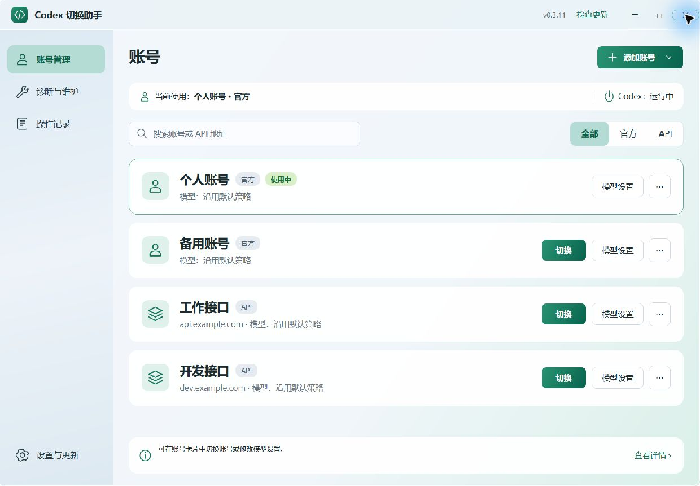

# Codex Profile Switcher

[](https://github.com/IIMovoMII/Codex-Profile-Switcher/releases)
[](https://github.com/IIMovoMII/Codex-Profile-Switcher/releases)
[](LICENSE.txt)

**A Windows desktop application for managing and switching Codex OAuth accounts and API profiles while preserving a shared local workspace.**

面向 Windows 的 Codex 账号与 API 管理工具。管理多个官方账号和 API 连接，沿用现有 Codex 聊天、项目和工作目录。



*界面示例使用合成账号，不含真实凭据。*

## 安装

从 [GitHub Releases](https://github.com/IIMovoMII/Codex-Profile-Switcher/releases) 下载 `Codex-Profile-Switcher-Setup-版本.exe`。安装器面向当前 Windows 用户，不要求管理员权限。安装时可选择创建桌面快捷方式；桌面和开始菜单快捷方式都使用固定启动入口。

当前稳定版为 **[0.3.14](https://github.com/IIMovoMII/Codex-Profile-Switcher/releases/tag/v0.3.14)**，补齐分页历史投影与 JSONL 字节偏移适配，修复普通切换被拦截、中文字节索引及 WAL 增量遗漏。完整内容见 [0.3.14 更新公告](docs/zh-CN/releases/0.3.14.md)，应用内使用相同公告。0.2.x 是旧版 PowerShell 程序。

安装和卸载向导使用简体中文，安装包自带 .NET 10 运行时。日常运行不需要 .NET SDK、PowerShell、Python、Node.js 或额外 SQLite 安装。

安装包主要包含免安装依赖所需的 .NET/WPF 运行时。0.3.10 使用更高压缩率，并仅发布简体中文附加语言资源（英文内置资源保留）；保留完整框架程序集与全部应用功能。

## 功能

- 添加、导入、编辑、重命名、删除和重新授权官方/API 档案。
- 切换与重新应用账号配置；保留账号独立模型、上下文、代理策略以及“继承”和“保留当前值”的语义。
- API 模型目录可使用独立的官方账号快照或指定的手动 JSON 文件；官方账号继续使用 Codex 原生目录更新。
- 共享聊天和项目，隔离账号专属界面状态，保留用户偏好。
- 历史兼容准备、增量处理、项目投影、环境检查和可取消的操作进度。
- 启动时检查 GitHub 稳定版；下载后校验 SHA-256，用户确认后才运行安装程序。
- GitHub API 限流或连接失败时回退到项目官方 Release 网页；显示具体原因，不要求提供 GitHub Token。
- 应用内显示与 GitHub Release 同源的版本公告，离线保留当前版本说明；公告获取失败不阻断版本检查。
- 数据位置优先默认及自动识别，失效才手动选择；已完成备份和更新缓存按规则限量保留。

## 首次使用

1. 安装并打开“Codex 账号切换”。
2. 已有登录信息时选择“导入当前账号”；也可以添加官方账号或 API 档案。
3. 切换前退出 Codex Desktop 和 Codex CLI；切换完成后重新启动 Codex。

“诊断与维护 → 重新检查”显示实际 Codex CLI 路径。自动查找覆盖 Desktop bin 版本目录、PATH、npm 原生程序及已知 Programs/Codex 布局；自定义安装可通过 `CODEX_CLI_PATH` 或 `--codex-exe` 指定原生 EXE。查找顺序和其他文件类别的兼容范围见[位置兼容说明](docs/zh-CN/PATH_COMPATIBILITY.md)。

图形界面通过根目录固定入口 `CodexProfileSwitcher.vbs` 启动。`Codex切换.vbs` 和 `start.vbs` 保留为兼容入口；`codex-switcher.cmd` 提供命令行程序。升级会更新固定入口的路径指针，不更换快捷方式目标。

## 页面入口

| 页面 | 常用操作 |
| --- | --- |
| 账号管理 | 搜索与筛选账号，卡片直接切换或打开模型设置；右上角添加/导入账号，卡片 `···` 中编辑名称、重新应用、重新授权或删除 |
| 账号设置面板 | 右侧分为账号信息、模型设置、网络与上下文；模型可从本地目录选择或输入 ID，显示实际文件、来源与更新时间 |
| 诊断与维护 | 重新检查运行环境；增量/完整历史准备、项目归属及桌面兼容检查与修复 |
| 操作记录 | 查看、刷新和复制经过敏感信息过滤的持久操作记录 |
| 设置与更新 | 检查/下载/安装更新、启动自动检查开关、默认策略、数据位置与版本信息 |

保存账号配置不会立即切换。切换到该账号或在 `···` 中重新应用时，才使用新的设置。首次添加官方账号而当前没有认证时，会执行初始化。耗时操作在底部显示进度；取消后等待安全收尾完成。

详细用法、模型目录格式和数据边界见[图形版使用说明](docs/zh-CN/INSTALL.md)。

## 数据与隐私

- 档案凭据和备份保存在 `%LOCALAPPDATA%\CodexProfileSwitcher`，使用当前 Windows 用户的 DPAPI 保护。
- 聊天和项目沿用现有 `CODEX_HOME`；安装和卸载不会清理这两个数据目录。
- 更新检查访问 GitHub Releases。安装包必须与对应 Release 的 SHA-256 清单匹配后才可启动。
- 已完成历史/项目备份每类最多 3 份，超过 14 天或合计 256 MB 时优先清理旧备份，每类至少保留最新 1 份。更新包保留最近 1 个，未完成下载超过 24 小时清理；待恢复或不明材料、账号、聊天和模型目录保留。
- 数据位置失效时可选择原文件夹；验证后仅在 `%APPDATA%\CodexProfileSwitcher\locations.json` 记住路径，不移动数据。档案与凭据仍绑定原 `CODEX_HOME`，不会静默改绑。
- 请勿提交认证文件、API Key、账号快照、真实聊天、运行日志或本机备份。

## 开发

项目使用 C#、.NET 10、WPF、CommunityToolkit.Mvvm、System.Text.Json、Microsoft.Data.Sqlite、Windows DPAPI、xUnit 和 Inno Setup 6。正常运行的业务逻辑全部由 C# 实现；保留的 PowerShell 脚本仅用于构建、隔离预览、入口及安装验证。旧业务脚本、旧界面和过时测试已退出当前源码树，历史实现可从旧版本标签查阅。

```powershell
dotnet build .\CodexProfileSwitcher.sln
dotnet test .\CodexProfileSwitcher.sln
.\build-installer.ps1
```

构建安装包需要 .NET 10 SDK 和 Inno Setup 6。安装器采用自包含 Windows x64 发布，不启用 trimming 或 NativeAOT。功能映射、关键决定和隔离验证状态见 [REFACTOR_PLAN.md](REFACTOR_PLAN.md)；贡献要求见 [CONTRIBUTING.md](CONTRIBUTING.md)。

当前源码版本为 **0.3.14**。隔离测试不等于真实账号登录、真实 API 使用或跨机器验证。项目采用 [MIT License](LICENSE.txt)。
