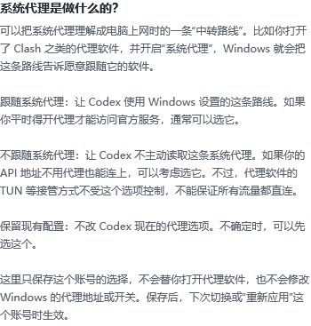

# 图形版使用说明

当前版本：0.2.6-preview，支持 Windows 10/11 64 位。

## 下载和安装

从 [GitHub Releases](https://github.com/IIMovoMII/Codex-Profile-Switcher/releases) 下载最新的 **Codex-Profile-Switcher-Setup-版本.exe**。安装器默认安装到当前用户的 **%LOCALAPPDATA%\\Programs\\CodexProfileSwitcher**，不要求管理员权限。可选创建桌面快捷方式，也会创建开始菜单入口。

安装不会登录账号、改 Codex 配置或启动 Desktop。卸载程序只移除切换器文件和快捷方式，保留账号档案、聊天、项目和备份。

需要 PowerShell 5.1、Windows Presentation Foundation 和 Windows Script Host。图形界面不要求 Node.js、Python 或外部 SQLite。

## 第一次使用

1. 完全退出 Codex Desktop 和 Codex CLI。
2. 已登录的用户点击“导入当前账号”；新用户点击“添加账号”。
3. 选择官方 ChatGPT OAuth 或自定义 API。官方账号在浏览器登录，API 需要接口地址和 Key。

切换器始终沿用已有的 **CODEX_HOME**。登录凭据和界面快照分别保存；聊天、项目和工作目录不会按账号复制。

## 管理账号

账号卡片用于切换连接。右侧菜单可编辑名称与配置、重新登录官方账号或移除本地档案。

模型、上下文窗口和系统代理在添加账号或“编辑名称与配置”中按账号设置。保存后在下次切换或“重新应用”时生效。留空模型或上下文会保留 Codex 当前值。编辑当前 API 的地址或 Key 后，需要重新应用才会更新当前连接。

系统代理的“不跟随”只控制 Codex 是否读取 Windows 的系统代理设置，不保证绕过 TUN 等其他流量接管方式。切换器不会修改 Windows 代理地址或开关。

切换前应退出 Codex Desktop 和 CLI。工具会检查相关进程；不会强行终止你的工作。

## 模型目录保持

官方账号始终使用 Codex Desktop 原生模型更新。切回官方账号时会移除切换器使用的顶层 **model_catalog_json** 覆盖，不执行 CLI 的模型查询，不写原生 **models_cache.json**，也不固定任何模型名单。

在 API 账号的“编辑名称与配置”中选择维护方式：

| 维护方式 | 目录来源 | 更新方式 |
| --- | --- | --- |
| 手动维护目录（原有账号的默认方式） | 此账号指定的 JSON；留空使用 **%LOCALAPPDATA%\CodexProfileSwitcher\relay-models.json** | 自行编辑，或“选择 JSON…”引用从可信 Codex 安装导出的完整目录 |
| 跟随官方目录 | 所选官方账号的独立快照 **%LOCALAPPDATA%\CodexProfileSwitcher\model-catalogs\official-账号摘要.json** | 正常离开该官方账号、切换认证之前，从本地官方缓存同步 |

每个 API 账号可选择不同来源或手动文件。改为跟随后仍保留原手动路径；切回手动方式即可继续使用。自动快照与手动文件分开保存，同步不会覆盖 **relay-models.json** 或用户指定的手动目录。

同步只读取切换脚本实际解析的 **CODEX_HOME\models_cache.json**，默认是 **%USERPROFILE%\.codex\models_cache.json**。核对当前官方身份与缓存的原生来源摘要相符后，保存完整的 **models** 数组，包括展示名称、上下文、推理档位、能力和未知字段；不导出账号等缓存外层数据。每个官方账号有独立快照与来源记录。

缓存缺失、损坏、为空或来源无法确认时，仅显示简短结果并保留旧快照，账号切换继续。尚未配置有效目录时同样允许切换，并提示模型列表可能不完整。高级 **config-api / config-official** 快速入口不执行目录同步，只使用已经保存的目录。

设置区显示维护方式、实际路径、来源及更新时间，提供“打开模型目录文件”和“打开所在文件夹”。首次打开尚不存在的手动文件时会创建空的编辑骨架；请从完整 Codex 目录填入模型信息。没有官方账号时无需登录官方，已有手动目录可以长期使用和编辑。导入文件顶层应含 **models** 数组，数组中每项保留完整 Codex 模型对象；不能仅填写模型名称或使用普通 **/v1/models** 响应替代。

目录修改或切换后，完全退出并重新启动 Codex 生效。目录中出现模型不代表 API 中转站已经支持调用。此功能只处理目录来源、独立快照和配置引用；现有账号对模型、上下文、推理强度及代理的设置仍按原流程保留或应用。

## 更新

每次打开图形界面时，切换器会在隐藏后台请求 GitHub 最新稳定版信息，最长等待 8 秒，不阻塞窗口。只有检测到更新时才显示更新按钮。网络不可用、超时或 GitHub 没有稳定版时，账号功能仍可使用。

点击更新后，切换器先询问，再从该项目的 GitHub Release 下载安装包和 SHA-256 文件。校验通过后启动 Inno Setup 安装程序。安装器保留现有 **%LOCALAPPDATA%\\CodexProfileSwitcher** 与 **CODEX_HOME**。切换器不静默下载或安装更新。

更新来源为[公开 GitHub 仓库](https://github.com/IIMovoMII/Codex-Profile-Switcher/releases)。源码版开发启动（使用 NoShow 测试模式）不执行网络检查。

## 数据与安全

- 聊天、项目、config.toml、auth.json 和 API Key 不发送给更新服务。
- 更新检查请求只访问 GitHub Releases API；下载也只接受本项目 GitHub Release 的 HTTPS 资源。
- 安装包 SHA-256 必须与同一 Release 附件一致，否则文件会被丢弃，不会运行。
- 本地档案和备份位于 **%LOCALAPPDATA%\\CodexProfileSwitcher**，由当前 Windows 用户的 DPAPI 保护。复制到另一用户或电脑不能恢复加密凭据。
- 当前生效的 auth.json 仍由 Codex 本身按文件认证机制维护。
- 排查问题时只上传必要日志，并先删除邮箱、用户路径、账号 ID、令牌、API 地址、聊天内容和项目名称。

## 预览版边界

自动化隔离测试使用临时目录、模拟 CLI 和测试 OAuth 数据。它们不能替代真实账号登录、真实 API 请求或跨机器验证。本项目依赖 Codex Desktop 的本地数据结构；客户端重大升级后，应等待兼容版本，不要手动恢复未知旧备份。

切换器用于管理本机连接，不改变 ChatGPT 或 API 服务端账号权限、套餐、额度或账单。
